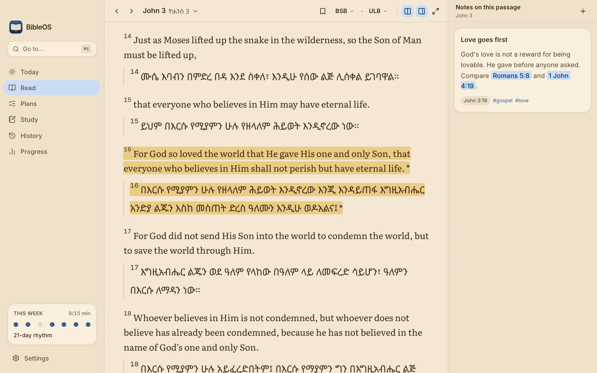

# BibleOS

BibleOS is a free, local-first Bible study app for Mac, Windows and Linux. Read Amharic and English side by side, keep notes and highlights, follow reading plans and track your reading habit. Everything stays on your computer: there's no account, and it works offline.



## Download

Get the latest version from **[the BibleOS website](https://bible.roobi.dev/)** or **[the latest release](https://github.com/roobiwebdev/BibleOS-releases/releases/latest)**:

| Computer                                | File                                                    |
| --------------------------------------- | ------------------------------------------------------- |
| Mac (Apple Silicon or Intel), macOS 12+ | `BibleOS_<version>_universal.dmg`                       |
| Windows 10 or 11                        | `BibleOS_<version>_x64-setup.exe`                       |
| Linux (x64)                             | `.AppImage`, `.deb` (Debian, Ubuntu) or `.rpm` (Fedora) |

Once installed, BibleOS checks for new versions when it opens and asks before installing one.

## Install

The quickest way is one command, which downloads the latest release, installs it and opens it:

```bash
# Mac or Linux (Terminal)
curl -fsSL https://bible.roobi.dev/install.sh | sh
```

```powershell
# Windows (PowerShell)
irm https://bible.roobi.dev/install.ps1 | iex
```

To install by hand instead, download the file for your computer from the table above. BibleOS is an independent free app, so its installers aren't signed with paid Apple or Microsoft certificates. Your computer will warn you the first time. Updates are signed with BibleOS's own key and checked before they install.

**Mac**

1. Open the `.dmg` and drag **BibleOS** into **Applications**.
2. Open BibleOS. macOS says it "could not verify" the app; click **Done**.
3. Open **System Settings → Privacy & Security**, scroll down and click **Open Anyway** next to BibleOS, then confirm. (On macOS 12–14 you can instead right-click the app and choose **Open**.)

**Windows**

1. Run `BibleOS_<version>_x64-setup.exe`.
2. If you see "Windows protected your PC", click **More info → Run anyway**.

**Linux**

- AppImage: `chmod +x BibleOS_*.AppImage && ./BibleOS_*.AppImage`
- Debian/Ubuntu: `sudo apt install ./BibleOS_*_amd64.deb`
- Fedora/openSUSE: `sudo dnf install ./BibleOS-*.x86_64.rpm`

## Features

- **Reader.** Chapters flow into each other as you scroll. Parallel reading puts a second translation beside the first, verse by verse, and focus mode hides everything but the text.
- **Amharic and English.** The whole interface is available in Amharic, dates can use the Ethiopian calendar, and Ethiopic fonts are bundled so text renders the same offline.
- **Highlights, notes and collections.** Five highlight colours (promise, command, prayer, insight, question), tagged notes with `[[John 3:16]]` links between passages, bookmarks and collections. Annotations are stored per verse, so they show up in every translation.
- **Search.** Search the whole Bible, one testament or one book. Amharic letters that sound alike (ሀ, ሐ, ኀ) match each other, while the displayed text stays exactly as printed.
- **Reading plans.** Seven built-in plans, from the Sermon on the Mount to the Bible in a year, plus your own. A plan picks up where you left off.
- **Reading habit.** A daily goal in minutes, a week of dots, a year-long heatmap and how much of the Bible you have read. Grace days and rest days keep one missed day from undoing the week.
- **Everyday tools.** A command palette (⌘K or Ctrl+K) that understands references like `John 3:16` and `ዮሐ 3፥16`, a Today screen, reading history, three themes (Paper, Sepia, Night) and adjustable text size, spacing and line width.
- **Backups.** Export everything to one file and import it elsewhere, export notes as Markdown, and keep the daily automatic backup.

### Bundled translations

| Translation                          | Language | Scope         | Licence                     |
| ------------------------------------ | -------- | ------------- | --------------------------- |
| Amharic Unlocked Literal Bible (ULB) | Amharic  | Whole Bible   | CC BY-SA 4.0                |
| መጽሐፍ ቅዱስ 1962 (New Testament)        | Amharic  | New Testament | Non-commercial, with notice |
| King James Version (KJV)             | English  | Whole Bible   | Public domain               |
| World English Bible (WEB)            | English  | Whole Bible   | Public domain               |
| Berean Standard Bible (BSB)          | English  | Whole Bible   | Public domain               |

The build downloads each translation from a pinned upstream source and stops if its SHA-256 hash doesn't match, so scripture can't change without review. The full notices are in [`packages/bible-data/src/manifest.ts`](packages/bible-data/src/manifest.ts) and in the app under Settings → Licences.

## Tech stack

- **Desktop app.** Tauri 2, with a small Rust layer for windowing, updates and SQLite access (rusqlite with bundled SQLite)
- **Interface.** React 19, TypeScript, Vite, TanStack Router, Tailwind CSS and shadcn/ui components
- **Data.** One read-only SQLite database per translation, plus a read-write study database with Drizzle migrations
- **Website.** React and Vite, pre-rendered and hosted on Vercel at [bible.roobi.dev](https://bible.roobi.dev/)
- **Tooling.** pnpm workspaces, Nx, Vitest, Oxlint and Oxfmt
- **Releases.** GitHub Actions in [BibleOS-releases](https://github.com/roobiwebdev/BibleOS-releases) build the installers and publish the signed update feed

## Project structure

```
apps/desktop          The BibleOS app (Tauri + React)
apps/site             The website at bible.roobi.dev
packages/bible-core   Books, references, search, reading plans, habits, Ethiopian calendar
packages/bible-data   Builds the translation databases from pinned USFM sources
packages/local-api    Validated commands that read and write the study database
packages/local-db     Study database schema and migrations
packages/ui           Shared UI components and theme tokens
release-repo/         Canonical copies of the BibleOS-releases workflows and README
docs/engineering/     Design notes (start with desktop.md)
```

The repo started from a full-stack web starter. `apps/web`, `apps/native`, `apps/docs` and the server packages (`api`, `auth`, `db`, `core`) come from it. They are not part of the desktop app. They stay in the repo because a future sync server could reuse them.

## Development

You need Node 24, pnpm 11 and Rust. On Linux, also install the [Tauri system dependencies](https://v2.tauri.app/start/prerequisites/).

```bash
pnpm install
pnpm --filter desktop bibles     # build the bundled translations (once)
pnpm --filter desktop dev        # run the app
```

| Command                          | What it does                                                   |
| -------------------------------- | -------------------------------------------------------------- |
| `pnpm --filter desktop dev:vite` | Run the interface in a browser, reading preview JSON scripture |
| `pnpm --filter desktop build`    | Build an installer for this computer                           |
| `pnpm --filter site dev`         | Run the website locally                                        |
| `pnpm check-types`               | Type-check every workspace project                             |
| `pnpm lint`                      | Lint with Oxlint                                               |
| `pnpm test`                      | Run the unit tests                                             |
| `pnpm check`                     | Lint, format check, type check and tests                       |

[docs/engineering/desktop.md](docs/engineering/desktop.md) explains how the app is built and why. [docs/engineering/releasing.md](docs/engineering/releasing.md) covers releases and the update signing key.

## Licence

The BibleOS code is under the [MIT licence](LICENSE).

Bible translations are not covered by it. Each keeps its own licence, listed in the table above, in [`packages/bible-data/src/manifest.ts`](packages/bible-data/src/manifest.ts) and in the app under Settings → Licences. The Literata, Inter, Noto Serif Ethiopic and Noto Sans Ethiopic fonts are under the SIL Open Font License 1.1. Parts of the website's demo player are adapted from MIT-licensed code; see [release-repo/THIRD_PARTY_NOTICES.md](release-repo/THIRD_PARTY_NOTICES.md).

## Author

BibleOS is built by [Roobi](https://roobi.dev), a senior software engineer. Report bugs or suggest changes in [issues](https://github.com/roobiwebdev/BibleOS/issues).
